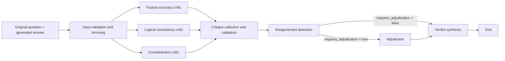

# LLM Output Arbitration System

A Python prototype for evaluating a language model's generated answer against the original question. The project uses a LangGraph graph to run three critics in parallel: factual accuracy, logical consistency, and completeness. Each critic returns a structured evaluation with a score, identified issues, and a confidence level.

The graph collects the three critiques, detects disagreements, adjudicates explicit conflicts when needed, and produces a structured verdict.

## How it works



1. `parse_input` trims leading and trailing whitespace and rejects an empty question or answer.
2. The three critic nodes receive the same input and call language models in parallel.
3. The graph state accumulates their responses in `critiques`. Each critic makes up to two attempts for transient failures only (timeouts, connection errors, rate limits, or server errors). After a definitive failure, it records its name in `failed_critics` without stopping the others.
4. `collect_critiques` identifies missing or duplicate dimensions and sets `critiques_complete`. The result is complete only when each of the three dimensions appears exactly once and no critic has failed.
5. `detect_disagreements` compares explicit claims in issues reported by different critics. When at least two critics report issues, a structured evaluation looks for incompatible claims about the same aspect of the answer; invalid or duplicate references are discarded. Only confirmed contradictions enter `disagreements` and set `requires_adjudication`. Different scores, an issue that another critic does not mention, and differences between dimensions are not sufficient.
6. The graph sends the state to `adjudicator` when `requires_adjudication` is true. It uses a structured OpenAI evaluation to confirm or dismiss issues reported by the critics. Without a disagreement, the graph goes directly to `synthesize_verdict`.
7. `synthesize_verdict` produces a `VerdictSchema` without another model call. Only issues explicitly confirmed by the adjudicator enter `confirmed_issues`; dismissed issues enter `dismissed_issues`, and the rest enter `unverified_issues`. Without adjudication, all critic issues remain in `unverified_issues`. Confidence decreases when evaluations are missing or when critics fail or dimensions are duplicated.

When a critic fails, the other evaluations remain in `critiques`, the missing dimension appears in `missing_dimensions`, and `critiques_complete` is `False`. When all critics fail, `critiques` is empty and the verdict has `status="inconclusive"`, zero confidence, and no confirmed issues. The required score of 1 is only a placeholder in that case, not an evaluation of the answer.

`VerdictSchema` contains `overall_score` (1 to 10), `confidence` (0 to 1), `confirmed_issues`, `dismissed_issues` (each with a reason), `unverified_issues`, `summary`, and `status` (`assessed` or `inconclusive`). The score is the average of the available critic scores, converted to a 1-to-10 scale; confirmed or unverified critical issues cap it at 4. Confidence is a fixed heuristic based on coverage of the three dimensions. It is capped at 0.75 for complete evaluations and reduced for partial ones; it is not a statistically calibrated probability. No factual claims are independently verified at this stage.

Each critique follows `CritiqueSchema`:

| Field | Meaning |
| --- | --- |
| `dimension` | `accuracy`, `logic`, or `completeness` |
| `score` | A score from 1 to 5 for the evaluated dimension |
| `issues` | Issues with a quoted excerpt (when applicable), description, and severity (`low`, `medium`, `high`, or `critical`) |
| `confidence` | The critic's stated confidence, from 0 to 1 |

The scores represent model evaluations, not independent fact checks. The factual accuracy critic does not consult external sources in this version.

## Stack

- **Python 3.14** and **uv** for the environment and dependencies.
- **LangGraph** for execution flow and shared state.
- **LangChain**, **langchain-openai**, and **langchain-google-genai** for model calls.
- **Pydantic** for validating critique structure.
- **python-dotenv** for loading environment variables from `.env`.

The models are defined in the code: `gpt-5` for factual accuracy, `gemini-3.5-flash` for logical consistency, and `gpt-5-mini` for completeness. Other libraries are listed as dependencies but are not yet part of the implemented flow.

## Prerequisites and setup

- Python 3.14 and [uv](https://docs.astral.sh/uv/) installed.
- OpenAI and Google API keys with access to the configured models. Model calls may incur provider charges.

From the repository root:

```bash
uv sync --frozen
cp .env.example .env
```

Add at least the following to `.env`:

```dotenv
OPENAI_API_KEY=your_openai_key
GOOGLE_API_KEY=your_google_key
```

The `.env.example` file already includes optional LangSmith settings for observability. You must add `GOOGLE_API_KEY` to `.env` because it is not yet in the example file. Do not commit real API keys; `.env` is in `.gitignore`.

## Run

The current example uses the question “What is the capital of France?” and the answer “The capital of France is Berlin.”:

```bash
uv run python -m src.arbitration.main
```

The program prints each critique's dimension, score, confidence, and issues. To evaluate another input, change `original_question` and `generated_output` in `src/arbitration/main.py`.

You can also start the LangGraph development server to interact with the `arbitration` graph defined in `langgraph.json`:

```bash
uv run langgraph dev --no-browser
```

The input state requires `original_question` and `generated_output`. The example in `src/arbitration/main.py` shows the full state format. To validate only the graph configuration without calling the models:

```bash
uv run langgraph validate -c langgraph.json
```

To test both routes without model calls, run the tests that replace the critics and detector with simulated results:

```bash
uv run python -m unittest tests.test_graph_routing -v
```

To simulate transient and permanent model failures and verify execution when all critics are unavailable:

```bash
uv run python -m unittest tests.test_critic_retries -v
```

## Main files

| Path | Responsibility |
| --- | --- |
| `src/arbitration/graph.py` | Graph construction and compilation |
| `src/arbitration/states.py` | State shared between nodes |
| `src/arbitration/schemas/critique.py` | Critique and issue schemas |
| `src/nodes/parse_input.py` | Basic input validation |
| `src/nodes/critics.py` | Calls to the three models |
| `src/nodes/collect_critiques.py` | Validation of the three critiques and failures |
| `src/nodes/detect_disagreements.py` | Detection of contradictions between reported issues |
| `src/arbitration/schemas/disagreement.py` | Structured conflict evaluation schema |
| `src/arbitration/schemas/verdict.py` | Adjudication and verdict schemas |
| `src/prompts/disagreements.py` | Instructions for comparing evaluations |
| `src/prompts/adjudicator.py` | Instructions for adjudicating conflicts |
| `src/nodes/adjudicator.py` | Structured decisions about reported issues |
| `src/nodes/synthesize_verdict.py` | Deterministic verdict synthesis |
| `src/prompts/` | Evaluation instructions for each dimension |
| `src/arbitration/main.py` | Command-line example |
| `langgraph.json` | Graph registration for the LangGraph CLI |

## Current status and next steps

- **Implemented:** basic input validation, three parallel critics, and structured critiques.
- **Implemented:** identification of explicit contradictions between issues reported by different critics, and a decision on whether adjudication is needed. `gpt-5-mini` interprets the free-text descriptions; when fewer than two critics report issues, the detector returns without calling the model.
- **Implemented:** conditional routing after disagreement detection, with both routes connected to the end of the graph.
- **Implemented:** structured conflict adjudication and deterministic verdict synthesis on both graph routes, including an inconclusive result when all critics fail.
- **Not yet integrated:** context retrieval (RAG), tools, and persistence; the directories reserved for these parts have no implementation.
- **Known limitation:** the consistency node passes arguments to the prompt constructor in the reverse order of the function signature. This may swap the question and answer in the prompt sent to the model. Execution also depends on the availability of the configured APIs and models.
