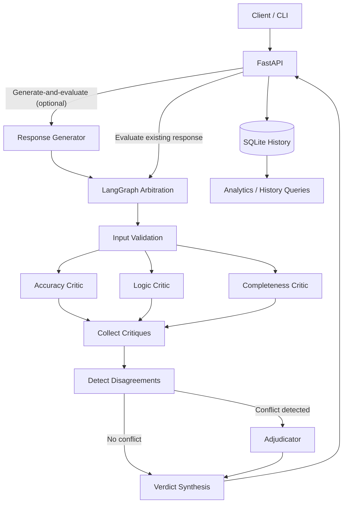

# LLM Output Arbitration System

**A multi-agent evaluation API for assessing LLM-generated responses across factual accuracy, logical consistency, and completeness.**

Built with **Python, LangGraph, FastAPI, and Pydantic**, the system runs specialized critics in parallel, consolidates their findings, adjudicates detected conflicts when necessary, and produces a structured verdict. The backend also supports response generation, arbitration history, basic analytics, and containerized execution.

> **Evaluation, not fact-checking:** Critic scores are model-generated judgments. The system does not currently verify factual claims against an independent retrieval source. Its confidence indicator is heuristic, not a calibrated probability of correctness.

## Features

- **Parallel critics:** accuracy, logic, and completeness evaluations using LangGraph.
- **Structured assessments:** scores, issue descriptions, severities, and critic confidence validated with Pydantic.
- **Conditional adjudication:** investigates explicit conflicts between reported issues when detected.
- **Verdict synthesis:** combines the available critiques into a score, status, and categorized issues.
- **FastAPI endpoints:** evaluate an existing response or generate a response before evaluating it.
- **Persistent history:** SQLite-backed retrieval of supported API executions by ID.
- **Batch arbitration:** submit multiple responses for evaluation.
- **Critic analytics:** aggregate evaluation counts, scores, reported issues, and adjudication decisions.
- **Developer workflows:** CLI, automated tests, LangGraph development tooling, and Docker Compose.

## Architecture



### How arbitration works

1. **Validate input:** `parse_input` validates and trims the original question and response.
2. **Run critics in parallel:** each agent evaluates the same input, focusing on its own dimension.
3. **Collect results:** LangGraph reducers combine critiques; missing, duplicate, or failed evaluations are tracked.
4. **Detect disagreements:** the detector compares reported issues for explicit conflicting claims, rather than treating different scores alone as disagreement.
5. **Adjudicate when required:** a model reviews the supplied issues, confirming or dismissing those it can justify.
6. **Synthesize the verdict:** deterministic logic produces a score, confidence indicator, issue classifications, summary, and status.

If a critic fails, successful critiques are retained. An incomplete run is marked **`inconclusive`** rather than silently treated as a full assessment.

### Critic dimensions

| Critic           | Responsibility                                                |
| ---------------- | ------------------------------------------------------------- |
| **Accuracy**     | Identify questionable or factually incorrect statements.      |
| **Logic**        | Assess internal consistency and reasoning.                    |
| **Completeness** | Check whether the response addresses the user's requirements. |

### Verdict format

A verdict contains:

| Field               | Description                                                      |
| ------------------- | ---------------------------------------------------------------- |
| `overall_score`     | Score from 1 to 10, derived from available critic scores.        |
| `confidence`        | Heuristic coverage indicator from 0 to 1; **not** a probability. |
| `confirmed_issues`  | Issues explicitly confirmed during adjudication.                 |
| `dismissed_issues`  | Issues rejected during adjudication, with reasons.               |
| `unverified_issues` | Reported issues without an adjudication decision.                |
| `summary`           | Brief description of the assessment.                             |
| `status`            | `assessed` or `inconclusive`.                                    |

**Scoring limitation:** critical issues that are confirmed or remain unverified cap the overall score at 4. If no critic succeeds, the schema's score of `1` is a placeholder, not a quality assessment. A high score on an incomplete evaluation should not be interpreted as a complete verdict.

## Tech stack

| Area                      | Technology                                                            |
| ------------------------- | --------------------------------------------------------------------- |
| Language and tooling      | Python 3.14, uv                                                       |
| Multi-agent orchestration | LangGraph, LangChain                                                  |
| Model access              | OpenAI via LangChain; model/provider selection is defined in the code |
| API and validation        | FastAPI, Pydantic                                                     |
| Persistence               | SQLite                                                                |
| Testing                   | pytest                                                                |
| Deployment                | Docker, Docker Compose                                                |
| Development workflow      | Spec-Driven Development (SDD), `AGENTS.md`                            |

The repository may retain dependencies for alternative providers, including Google GenAI. Check `backend/src/nodes/critics.py` for the **actual currently configured models**; the provider choice may change independently of the API contract.

## Repository structure

```text
.
├── .agents/                  # Agent development resources
├── backend/
│   ├── src/
│   │   ├── api/              # FastAPI routes, services, history and analytics
│   │   ├── arbitration/      # LangGraph, shared state and schemas
│   │   ├── nodes/            # Critics, detection, adjudication, synthesis
│   │   └── prompts/          # Critic and adjudicator instructions
│   ├── tests/                # Automated tests and evaluation cases
│   ├── docs/                 # Backend documentation
│   ├── reports/              # Evaluation reports
│   ├── Dockerfile
│   ├── langgraph.json
│   ├── pyproject.toml
│   ├── uv.lock
│   └── .env.example
├── openspec/                 # Spec-driven development artifacts
├── AGENTS.md                 # Architectural guardrails for coding agents
├── compose.yaml
└── README.md
```

Runtime-generated SQLite files, virtual environments, caches, and local secrets are not required to understand or use the source tree.

## Getting started

### Prerequisites

- Python 3.14 and [uv](https://docs.astral.sh/uv/), **or** Docker with Docker Compose.
- Valid API credentials for whichever model providers are configured in the backend.

### Run locally

From the **`backend/`** directory:

```bash
uv sync --frozen
cp .env.example .env
```

Configure the model credentials needed by your current setup in `backend/.env`:

```dotenv
OPENAI_API_KEY=your_openai_key
# GOOGLE_API_KEY=your_google_key  # Only if a Google model is configured
```

Never commit real credentials. Model API calls may incur costs.

Start the API:

```bash
uv run uvicorn src.api.main:app --host 127.0.0.1 --port 8000
```

Check that it is running:

```bash
curl -i http://127.0.0.1:8000/health
```

Interactive API documentation: **http://127.0.0.1:8000/docs**

### Run with Docker Compose

Create `backend/.env` as shown above, then run from the **repository root**:

```bash
docker compose up --build -d
docker compose ps
curl -i http://127.0.0.1:8000/health
```

Compose publishes the API on port `8000` by default and maintains SQLite history in a named volume. Set `API_PORT` if the default host port is unavailable. Stop without deleting persisted volume data:

```bash
docker compose down
```

## API usage

The routes below are based on the current backend documentation. See `/docs` for their precise request/response schemas.

### Generate and evaluate a response

```bash
curl -X POST http://127.0.0.1:8000/generate-and-evaluate \
  -H 'Content-Type: application/json' \
  -d '{"original_question":"Qual é a capital da França?"}'
```

The API generates a response, runs the arbitration graph, and returns the structured evaluation. This flow also persists a history record with a UUID and returns its identifier in `X-Arbitration-ID`.

### Evaluate an existing response

```bash
curl -X POST http://127.0.0.1:8000/evaluate \
  -H 'Content-Type: application/json' \
  -d '{"original_question":"What is the capital of France?","generated_output":"The capital of France is Berlin."}'
```

This evaluates a supplied response **without generating a new one**. In the documented implementation, this endpoint does **not** create a history record.

### Retrieve a saved arbitration

```bash
curl http://127.0.0.1:8000/v1/arbitrations/YOUR_ARBITRATION_UUID
```

Saved records include the original question, generated response, timestamps, execution status, and evaluation when available. Execution status (`pending`, `completed`, `failed`, `timed_out`) is distinct from verdict status (`assessed`, `inconclusive`).

### Basic critic analytics

```bash
curl -s http://127.0.0.1:8000/v1/analytics | python -m json.tool
```

Returns basic aggregates for arbitrations, critic scores and issue counts, plus adjudication activity. If no eligible records have been persisted, the totals are zero.

### Batch arbitration

The backend also supports batch evaluation. Use **`/docs`** for the batch route and its request schema; the exact route/payload has not been established in the supplied README and is deliberately not assumed here.

## Testing and development

From **`backend/`**, run the automated tests without making live provider calls where tests use mocked model responses:

```bash
uv run python -m pytest -q
```

The CLI allows a direct question-and-answer demonstration with real models:

```bash
uv run python -m src.arbitration.main
```

To validate the LangGraph configuration:

```bash
uv run langgraph validate -c langgraph.json
```

A LangGraph development server is also configured:

```bash
uv run langgraph dev --no-browser
```

### Evaluation dataset

The project includes an evaluation workflow for comparing critic scores and detected issues against expected test cases. The rule-based baseline does **not** independently establish factual correctness or semantic equivalence; external provider failures should be distinguished from genuine quality failures.

See `backend/tests/` and `backend/reports/` for the evaluation tests and generated reports. Running model-backed evaluations requires valid provider credentials.

## Known limitations

- **No independent evidence retrieval:** RAG or external fact checking is not integrated into the current arbitrator.
- **Heuristic confidence:** the verdict confidence score is not calibrated against ground-truth outcomes.
- **Provider availability:** quota, model availability, and service errors can produce partial or inconclusive evaluations.
- **Model diversity:** changing critics to use a shared provider may reduce independent perspectives.
- **Evaluation uncertainty:** a model's confirmation of an issue is not equivalent to external proof.

The existing README also flags a potential argument-order mismatch in a consistency prompt constructor. That code-level issue should be checked against the current implementation before it is treated as resolved.

## Roadmap

- [x] Multi-agent LangGraph arbitration
- [x] Conditional adjudication and verdict synthesis
- [x] FastAPI integration
- [x] SQLite history and retrieval
- [x] Batch arbitration
- [x] Basic analytics endpoint
- [x] Docker Compose
- [ ] Further improvements to evaluation quality and provider resilience

## Project approach

The FastAPI migration and later enhancements use **Spec-Driven Development (SDD)**. Project-specific architectural constraints are documented in the root [`AGENTS.md`](AGENTS.md), and specification artifacts are stored under `openspec/`. The intent is to evolve the HTTP layer without unnecessarily changing the underlying LangGraph pipeline.

---

**Core idea:** instead of generating another LLM answer and assuming it is correct, the system evaluates that answer through specialized critics and exposes the findings in a structured, inspectable format.
