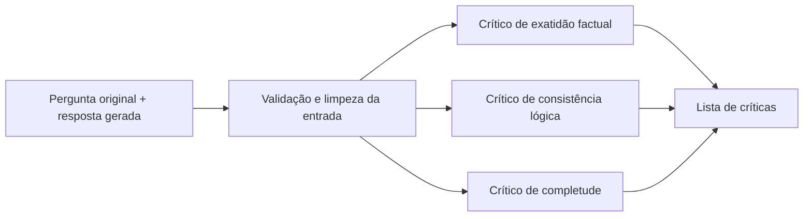

# LLM Output Arbitration System

Protótipo em Python para avaliar uma resposta gerada por um modelo de linguagem em relação à pergunta original. O projeto usa um grafo LangGraph para executar três críticos em paralelo: exatidão factual, consistência lógica e completude. Cada crítico retorna uma avaliação estruturada com nota, problemas encontrados e grau de confiança.

O nome do projeto descreve a arquitetura pretendida. **No estado atual, o grafo reúne as três críticas, mas ainda não arbitra divergências nem produz um veredito final.**

## Como funciona hoje



1. `parse_input` remove espaços nas extremidades e rejeita pergunta ou resposta vazia.
2. Os três nós críticos recebem a mesma entrada e executam chamadas a modelos de linguagem em paralelo.
3. O estado do grafo acumula as respostas no campo `critiques`.

Cada crítica segue o esquema `CritiqueSchema`:

| Campo | Significado |
| --- | --- |
| `dimension` | `accuracy`, `logic` ou `completeness` |
| `score` | Nota de 1 a 5 para a dimensão avaliada |
| `issues` | Problemas com trecho citado (quando aplicável), descrição e severidade (`low`, `medium`, `high` ou `critical`) |
| `confidence` | Confiança declarada pelo crítico, de 0 a 1 |

As notas representam avaliações dos modelos, não uma verificação independente dos fatos. O crítico factual não consulta fontes externas nesta versão.

## Stack

- **Python 3.14** e **uv** para ambiente e dependências.
- **LangGraph** para o fluxo de execução e o estado compartilhado.
- **LangChain**, **langchain-openai** e **langchain-google-genai** para as chamadas aos modelos.
- **Pydantic** para validar a estrutura das críticas.
- **python-dotenv** para carregar variáveis de ambiente do arquivo `.env`.

Os modelos estão definidos no código: `gpt-5` para exatidão factual, `gemini-3.5-flash` para consistência lógica e `gpt-5-mini` para completude. Outras bibliotecas constam nas dependências, mas ainda não participam do fluxo implementado.

## Pré-requisitos e configuração

- Python 3.14 e [uv](https://docs.astral.sh/uv/) instalados.
- Chaves de API da OpenAI e do Google com acesso aos modelos configurados. As chamadas podem gerar custos nos provedores.

Na raiz do repositório:

```bash
uv sync --frozen
cp .env.example .env
```

Preencha o `.env` com, no mínimo:

```dotenv
OPENAI_API_KEY=sua_chave_openai
GOOGLE_API_KEY=sua_chave_google
```

O arquivo `.env.example` já inclui opções de LangSmith para observabilidade; elas são opcionais para executar o exemplo. A variável `GOOGLE_API_KEY` precisa ser adicionada ao `.env`, pois ainda não aparece no modelo de arquivo. Não versione chaves reais; `.env` está no `.gitignore`.

## Executar

O exemplo atual usa a pergunta “What is the capital of France?” e a resposta “The capital of France is Berlin.”:

```bash
uv run python -m src.arbitration.main
```

O programa imprime dimensão, nota, confiança e problemas de cada crítica. Para avaliar outra entrada, altere `original_question` e `generated_output` em `src/arbitration/main.py`.

Também é possível iniciar o servidor de desenvolvimento do LangGraph para interagir com o grafo `arbitration` definido em `langgraph.json`:

```bash
uv run langgraph dev --no-browser
```

O estado de entrada requer `original_question` e `generated_output`. O exemplo em `src/arbitration/main.py` mostra o formato completo do estado. Para conferir apenas a configuração do grafo, sem chamar os modelos:

```bash
uv run langgraph validate -c langgraph.json
```

## Estrutura principal

| Caminho | Responsabilidade |
| --- | --- |
| `src/arbitration/graph.py` | Montagem e compilação do grafo |
| `src/arbitration/states.py` | Estado compartilhado entre os nós |
| `src/arbitration/schemas/critique.py` | Esquemas das críticas e problemas |
| `src/nodes/parse_input.py` | Validação básica da entrada |
| `src/nodes/critics.py` | Chamadas aos três modelos |
| `src/prompts/` | Instruções de avaliação para cada dimensão |
| `src/arbitration/main.py` | Exemplo de execução no terminal |
| `langgraph.json` | Registro do grafo para a CLI do LangGraph |

## Estado atual e próximos passos

- **Implementado:** validação básica da entrada, três críticos em paralelo e críticas estruturadas.
- **Ainda não implementado:** identificação de divergências entre críticos, decisão sobre necessidade de adjudicação, agente adjudicador e veredito final. Os campos correspondentes já existem no estado, mas nenhum nó os preenche. `src/arbitration/schemas/verdict.py` ainda está vazio.
- **Ainda não integrado:** recuperação de contexto (RAG), ferramentas e persistência; os diretórios reservados para essas partes não contêm implementação.
- **Limitação conhecida:** o nó de consistência passa os argumentos ao construtor do prompt em ordem inversa à assinatura da função. Isso pode trocar pergunta e resposta no prompt enviado ao modelo. A execução também depende da disponibilidade das APIs e dos modelos configurados.
