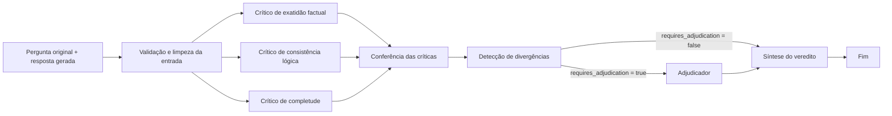

# LLM Output Arbitration System

Protótipo em Python para avaliar uma resposta gerada por um modelo de linguagem em relação à pergunta original. O projeto usa um grafo LangGraph para executar três críticos em paralelo: exatidão factual, consistência lógica e completude. Cada crítico retorna uma avaliação estruturada com nota, problemas encontrados e grau de confiança.

O grafo reúne três críticas, detecta divergências, adjudica conflitos explícitos quando necessário e produz um veredito estruturado.

## Como funciona hoje



1. `parse_input` remove espaços nas extremidades e rejeita pergunta ou resposta vazia.
2. Os três nós críticos recebem a mesma entrada e executam chamadas a modelos de linguagem em paralelo.
3. O estado do grafo acumula as respostas no campo `critiques`. Cada crítico faz até duas tentativas apenas para falhas transitórias (timeout, conexão, limite de taxa ou erro de servidor). Após uma falha definitiva, registra seu nome em `failed_critics` sem interromper os demais.
4. `collect_critiques` identifica dimensões ausentes ou duplicadas e define `critiques_complete`. O resultado é completo apenas quando as três dimensões aparecem uma vez cada e não há críticos com falha.
5. `detect_disagreements` compara afirmações explícitas nos problemas descritos por críticos diferentes. Quando pelo menos dois críticos relatam problemas, uma avaliação estruturada procura afirmações incompatíveis sobre o mesmo aspecto da resposta; referências inválidas ou repetidas são descartadas. Apenas contradições confirmadas entram em `disagreements` e ativam `requires_adjudication`. Notas diferentes, um problema sem menção equivalente por outro crítico e diferenças entre dimensões não bastam para isso.
6. O grafo envia o estado ao `adjudicator` quando `requires_adjudication` é verdadeiro; ele usa uma avaliação estruturada da OpenAI para confirmar ou descartar problemas relatados pelos críticos. Sem divergência, segue diretamente para `synthesize_verdict`.
7. `synthesize_verdict` produz um `VerdictSchema` sem nova chamada ao modelo. Apenas problemas confirmados explicitamente pelo adjudicador entram em `confirmed_issues`; os descartados entram em `dismissed_issues` e os demais em `unverified_issues`. Sem adjudicação, todos os problemas dos críticos ficam em `unverified_issues`. A confiança é reduzida quando faltam avaliações ou existem falhas ou dimensões duplicadas.

Quando um crítico falha, as avaliações dos demais permanecem em `critiques`, a dimensão ausente aparece em `missing_dimensions` e `critiques_complete` é `False`. Quando todos falham, `critiques` fica vazio e o veredito tem `status="inconclusive"`, confiança zero e nenhum problema confirmado. A nota obrigatória 1 é apenas um marcador nesse caso, não uma avaliação da resposta.

O `VerdictSchema` contém `overall_score` (1 a 10), `confidence` (0 a 1), `confirmed_issues`, `dismissed_issues` (cada um com motivo), `unverified_issues`, `summary` e `status` (`assessed` ou `inconclusive`). A nota vem da média das notas disponíveis dos críticos, convertida para a escala de 1 a 10; problemas críticos confirmados ou não verificados limitam a nota a 4. A confiança é uma heurística fixa de cobertura das três dimensões, limitada a 0,75 para avaliações completas e reduzida para avaliações parciais; não representa probabilidade estatisticamente calibrada. Nenhuma afirmação factual é verificada de forma independente nesta fase.

Cada crítica segue o esquema `CritiqueSchema`:

| Campo | Significado |
| --- | --- |
| `dimension` | `accuracy`, `logic` ou `completeness` |
| `score` | Nota de 1 a 5 para a dimensão avaliada |
| `issues` | Problemas com trecho citado (quando aplicável), descrição e severidade (`low`, `medium`, `high` ou `critical`) |
| `confidence` | Confiança declarada pelo crítico, de 0 a 1 |

As notas representam avaliações dos modelos, não uma verificação independente dos fatos. O crítico factual não consulta fontes externas nesta versão.

## Stack

- **Python 3.14** e **uv** para ambiente e dependências.
- **LangGraph** para o fluxo de execução e o estado compartilhado.
- **LangChain**, **langchain-openai** e **langchain-google-genai** para as chamadas aos modelos.
- **Pydantic** para validar a estrutura das críticas.
- **python-dotenv** para carregar variáveis de ambiente do arquivo `.env`.

Os modelos estão definidos no código: `gpt-5` para exatidão factual, `gemini-3.5-flash` para consistência lógica e `gpt-5-mini` para completude. Outras bibliotecas constam nas dependências, mas ainda não participam do fluxo implementado.

## Pré-requisitos e configuração

- Python 3.14 e [uv](https://docs.astral.sh/uv/) instalados.
- Chaves de API da OpenAI e do Google com acesso aos modelos configurados. As chamadas podem gerar custos nos provedores.

Na raiz do repositório:

```bash
uv sync --frozen
cp .env.example .env
```

Preencha o `.env` com, no mínimo:

```dotenv
OPENAI_API_KEY=sua_chave_openai
GOOGLE_API_KEY=sua_chave_google
```

O arquivo `.env.example` já inclui opções de LangSmith para observabilidade; elas são opcionais para executar o exemplo. A variável `GOOGLE_API_KEY` precisa ser adicionada ao `.env`, pois ainda não aparece no modelo de arquivo. Não versione chaves reais; `.env` está no `.gitignore`.

## Executar

O exemplo atual usa a pergunta “What is the capital of France?” e a resposta “The capital of France is Berlin.”:

```bash
uv run python -m src.arbitration.main
```

O programa imprime dimensão, nota, confiança e problemas de cada crítica. Para avaliar outra entrada, altere `original_question` e `generated_output` em `src/arbitration/main.py`.

Também é possível iniciar o servidor de desenvolvimento do LangGraph para interagir com o grafo `arbitration` definido em `langgraph.json`:

```bash
uv run langgraph dev --no-browser
```

O estado de entrada requer `original_question` e `generated_output`. O exemplo em `src/arbitration/main.py` mostra o formato completo do estado. Para conferir apenas a configuração do grafo, sem chamar os modelos:

```bash
uv run langgraph validate -c langgraph.json
```

Para testar os dois caminhos sem chamadas aos modelos, execute os testes que substituem os críticos e o detector por resultados simulados:

```bash
uv run python -m unittest tests.test_graph_routing -v
```

Para simular falhas transitórias e permanentes dos modelos, além de verificar a execução com todos os críticos indisponíveis:

```bash
uv run python -m unittest tests.test_critic_retries -v
```

## Estrutura principal

| Caminho | Responsabilidade |
| --- | --- |
| `src/arbitration/graph.py` | Montagem e compilação do grafo |
| `src/arbitration/states.py` | Estado compartilhado entre os nós |
| `src/arbitration/schemas/critique.py` | Esquemas das críticas e problemas |
| `src/nodes/parse_input.py` | Validação básica da entrada |
| `src/nodes/critics.py` | Chamadas aos três modelos |
| `src/nodes/collect_critiques.py` | Conferência das três críticas e das falhas |
| `src/nodes/detect_disagreements.py` | Detecção de contradições entre problemas relatados |
| `src/arbitration/schemas/disagreement.py` | Esquema da avaliação estruturada de conflitos |
| `src/arbitration/schemas/verdict.py` | Esquemas da adjudicação e do veredito |
| `src/prompts/disagreements.py` | Instruções para comparar as avaliações |
| `src/prompts/adjudicator.py` | Instruções para adjudicar conflitos |
| `src/nodes/adjudicator.py` | Decisões estruturadas sobre problemas relatados |
| `src/nodes/synthesize_verdict.py` | Síntese determinística do veredito |
| `src/prompts/` | Instruções de avaliação para cada dimensão |
| `src/arbitration/main.py` | Exemplo de execução no terminal |
| `langgraph.json` | Registro do grafo para a CLI do LangGraph |

## Estado atual e próximos passos

- **Implementado:** validação básica da entrada, três críticos em paralelo e críticas estruturadas.
- **Implementado:** identificação de contradições explícitas entre problemas relatados por críticos diferentes e decisão sobre necessidade de adjudicação. A interpretação das descrições em texto livre usa `gpt-5-mini`; quando não há problemas de pelo menos dois críticos, o detector retorna sem chamar o modelo.
- **Implementado:** roteamento condicional após a detecção de divergências, com os dois caminhos ligados ao fim do grafo.
- **Implementado:** adjudicação estruturada de conflitos e síntese determinística de um veredito em ambos os caminhos do grafo, inclusive resultado inconclusivo quando todos os críticos falham.
- **Ainda não integrado:** recuperação de contexto (RAG), ferramentas e persistência; os diretórios reservados para essas partes não contêm implementação.
- **Limitação conhecida:** o nó de consistência passa os argumentos ao construtor do prompt em ordem inversa à assinatura da função. Isso pode trocar pergunta e resposta no prompt enviado ao modelo. A execução também depende da disponibilidade das APIs e dos modelos configurados.
